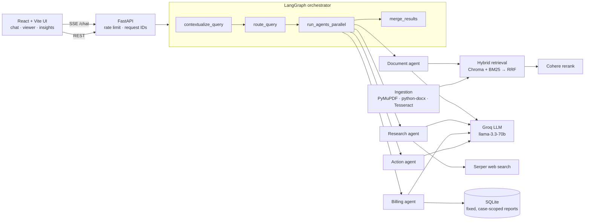

# LexMind AI

**Multi-agent legal intelligence platform: ask questions about case files and get streamed, page-cited answers, risk analysis, timelines and hearing prep.**

Upload contracts, evidence and pleadings (PDF, DOCX, scanned images). A LangGraph orchestrator routes each question to specialised agents, which run in parallel. Answers stream token by token and cite the exact document page; clicking a citation opens the PDF at that page.

---

## Highlights

| | |
|---|---|
| **Real-time streaming** | Tokens stream from the LLM over SSE while a live panel shows each agent's status (routing → running → done) |
| **Multi-agent orchestration** | LangGraph graph: contextualise → route → run agents in parallel → merge. Document, research, billing and action agents |
| **Hybrid RAG, measured** | Dense embeddings + BM25 fused with Reciprocal Rank Fusion, optional Cohere rerank. Evaluated on a golden set: hybrid beats either retriever alone (see [Evaluation](#evaluation)) |
| **Grounded citations** | Every claim cites `[Source: file, Page N]`; citations not backed by a retrieved chunk are dropped |
| **Conversation memory** | Follow-ups ("and after termination?") are rewritten into standalone questions using recent history |
| **Case insights** | Summary, risk register (HIGH/MEDIUM/LOW), event timeline and hearing-prep sheet |
| **Human-in-the-loop actions** | Drafts emails, calendar events (.ics) and PDF reports. Nothing is sent; the user reviews, then clicks |
| **Production basics** | Path-safe uploads, case-scoped queries, rate limiting, request IDs, JSON logs, migrations, Docker, CI |

---

## Architecture



**How a question flows**

1. `contextualize_query`: if there is history, the LLM rewrites the follow-up as a standalone question.
2. `route_query`: the LLM returns JSON subtasks; unknown agents are dropped and failures fall back to the document agent.
3. `run_agents_parallel`: agents run in a thread pool. The first streaming-capable agent's tokens are forwarded live through LangGraph's custom stream writer; the other sections follow when they finish.
4. `merge_results`: builds the final text exactly as it was streamed, so the saved message matches what the user saw.

| Agent | Does | Safety |
|---|---|---|
| `document_agent` | Hybrid retrieval (20 candidates) → rerank (top 5) → cited answer, streamed | Unverifiable citations removed |
| `research_agent` | Serper web search → synthesised precedents, streamed | Sources listed as links |
| `analytics_agent` | Picks one of five predefined billing reports | LLM never writes SQL; every query is bound to the active case |
| `action_agent` | Structured email / calendar / report drafts | Nothing executes without a user click |

---

## Evaluation

`backend/eval/` holds a synthetic two-contract corpus (an NDA and a services agreement with **deliberately similar clauses**) and 24 golden questions worded differently from the source text. A hit means the right **document and page** came back.

```bash
cd backend
python -m eval.run_eval            # offline retrieval ablation
python -m eval.run_eval --llm      # + answer citation accuracy (needs GROQ_API_KEY)
```

| Retriever (top 5) | hit@1 | hit@3 | MRR |
|---|---|---|---|
| Dense only (MiniLM embeddings) | 0.62 | 1.00 | 0.81 |
| Sparse only (BM25) | 0.62 | 0.92 | 0.76 |
| **Hybrid (RRF), as used by the app** | **0.75** | **1.00** | **0.87** |

The same evaluation runs in CI as a **quality gate**: a change that lowers hybrid retrieval quality, or makes it worse than either retriever alone, fails the build.

---

## Tech stack

| Layer | Stack |
|---|---|
| Frontend | React 18, TypeScript, Vite, Tailwind CSS, TanStack Query, react-markdown, react-pdf |
| Backend | Python 3.12, FastAPI, SQLAlchemy 2 (typed models), Alembic, Uvicorn |
| AI | LangGraph, LangChain, Groq (`llama-3.3-70b-versatile`), Cohere Rerank, Serper |
| Retrieval | ChromaDB, ONNX MiniLM embeddings, rank-bm25, Reciprocal Rank Fusion |
| Ingestion | PyMuPDF, python-docx, Tesseract OCR |
| Quality | pytest (58 tests), Vitest + Testing Library (16 tests), ruff, mypy, ESLint, RAG eval gate |
| Ops | Docker, docker compose, GitHub Actions, Railway (API), Vercel (UI) |

---

## Quick start

### Option A: Docker (recommended)

```bash
cp backend/.env.example backend/.env      # add your API keys
docker compose up --build
docker compose exec backend python -m scripts.seed_demo   # optional demo case
```

UI: http://localhost:5173 · API docs: http://localhost:8000/docs

### Option B: run locally

Prerequisites: Python 3.11+, Node 20+, [Tesseract](https://github.com/tesseract-ocr/tesseract) (for scanned PDFs), API keys from [Groq](https://console.groq.com/) (required), [Cohere](https://dashboard.cohere.com/) and [Serper](https://serper.dev/) (optional).

```bash
# Backend
cd backend
python -m venv .venv
.venv\Scripts\activate          # Windows  (macOS/Linux: source .venv/bin/activate)
pip install -r requirements-dev.txt
cp .env.example .env            # then add your keys
python -m scripts.seed_demo     # optional demo case
uvicorn api.main:app --reload --port 8000
```

```bash
# Frontend (second terminal)
cd frontend
npm install
cp .env.local.example .env.local
npm run dev
```

The database schema is created and migrated automatically on startup (Alembic).

**Try it with the demo case:** *"What is the liability cap in each contract?"*, then *"and which one has the longer confidentiality period?"*; *"Which invoice is disputed and why?"*; *"Schedule a prep meeting on 2 March 2026 at 10am"*.

---

## Testing & quality

```bash
cd backend
pytest                      # 58 tests: API, security, streaming, agents, migrations, retrieval, eval gate
pytest -m "not slow"        # skip the tests that load the embedding model
ruff check . && mypy .

cd frontend
npm test                    # Vitest: streaming hook, markdown/citations, actions, .ics
npm run lint && npm run build
```

Backend tests run against a throw-away database and vector store with a scripted fake LLM: no network, no API keys.

---

## Project structure

```
LexMind-AI/
├── backend/
│   ├── api/              # FastAPI app, middleware (logging, auth, rate limit), routes
│   ├── agents/           # LangGraph orchestrator + document / research / analytics / action agents
│   ├── rag/              # ingestion, embeddings, hybrid retrieval, reranker, vector store
│   ├── services/         # summary, risks, timeline, hearing prep, PDF reports
│   ├── models/           # SQLAlchemy models + Pydantic API schemas
│   ├── migrations/       # Alembic migrations
│   ├── eval/             # RAG evaluation corpus, golden set, runner
│   ├── scripts/          # demo seed
│   ├── tests/            # pytest suite
│   ├── llm.py            # shared LLM client, streaming, JSON parsing
│   └── Dockerfile
├── frontend/
│   ├── src/components/   # Chat (messages, trace, viewer, action cards), Dashboard (insights)
│   ├── src/hooks/        # SSE streaming, data queries
│   ├── src/lib/          # API client, types, .ics builder
│   └── Dockerfile
├── docker-compose.yml
└── .github/workflows/ci.yml
```

---

## API overview

| Method | Endpoint | Description |
|---|---|---|
| `GET` | `/health` | Service health |
| `GET/POST` | `/cases` | List / create cases |
| `GET/DELETE` | `/cases/{id}` | Fetch / archive a case |
| `GET` | `/cases/{id}/messages` | Chat history |
| `GET` | `/cases/{id}/summary` · `/timeline` · `/risks` | Case insights |
| `POST` | `/cases/{id}/prep` | Hearing preparation sheet |
| `POST` | `/cases/{id}/reports/pdf` | Render a reviewed report draft as PDF |
| `POST` | `/upload?case_id=` | Upload a document (ingested in the background) |
| `GET/DELETE` | `/cases/{id}/documents[/{doc_id}]` | Documents with ingestion status |
| `POST` | `/chat` | Streaming multi-agent chat (SSE) |
| `GET` | `/analytics/billing` | Billing records |

Interactive docs: http://localhost:8000/docs

---

## Configuration

Backend (`backend/.env`; see `.env.example`):

| Variable | Default | Description |
|---|---|---|
| `GROQ_API_KEY` | (required) | Groq LLM key |
| `GROQ_MODEL` | `llama-3.3-70b-versatile` | Model name |
| `COHERE_API_KEY` | | Enables reranking (skipped if unset) |
| `SERPER_API_KEY` | | Enables the research agent's web search |
| `DATABASE_URL` | `sqlite:///./lexmind.db` | Database |
| `CHROMA_PERSIST_PATH` / `UPLOADS_DIR` | `./chroma_db` / `uploads` | Vector store and file storage |
| `ALLOWED_ORIGINS` | `http://localhost:5173` | CORS origins, comma-separated |
| `SECRET_KEY` | | Enables API-key auth when set |
| `MAX_FILE_SIZE_MB` | `50` | Upload limit |
| `LLM_TIMEOUT_SECONDS` / `LLM_MAX_RETRIES` | `60` / `2` | LLM call limits |
| `RATE_LIMIT_ENABLED` / `RATE_LIMIT_SCALE` | `true` / `1` | Per-IP limits on chat, upload and insight endpoints |
| `TRUST_PROXY` | `false` | Use `X-Forwarded-For` for client IPs (only behind your own proxy) |
| `LOG_FORMAT` / `LOG_LEVEL` | `text` / `INFO` | `json` for structured logs |
| `LANGSMITH_TRACING` / `LANGSMITH_API_KEY` | | Optional LangSmith tracing |

Frontend (`frontend/.env.local`): `VITE_API_URL` (backend URL), `VITE_API_KEY` (matches `SECRET_KEY`).

---

## Design decisions & trade-offs

- **The billing agent never writes SQL.** Free-form text-to-SQL over a shared database lets any user, or a prompt hidden in an uploaded document, read other cases. The LLM picks one of five parameterised reports instead, and `case_id` is always a bound parameter.
- **Upload paths come from IDs, never filenames.** Files are stored as `uploads/{case_id}/{doc_id}.pdf`; the original name lives only in the database, which closes path-traversal attacks.
- **One chunk never spans two pages.** Pages are chunked separately so every citation points at the exact page in the viewer.
- **RRF instead of score blending.** Dense and BM25 scores are on different scales; rank fusion needs no tuning, and the eval shows it beats both retrievers.
- **The streamed text is the saved text.** The merge node rebuilds the answer from exactly what was streamed, so a reload shows the same message the user watched being written.
- **The API-key mode is a demo guard, not user auth.** `VITE_API_KEY` ships in the browser bundle. Real deployments need per-user authentication (see roadmap).
- **SQLite, Chroma and in-memory rate limits** keep this a single-container deploy. Each has a drop-in scale-out path: Postgres + pgvector, a Chroma server, and Redis.

---

## Roadmap

- Per-user authentication (OAuth / JWT) with case ownership
- Postgres + pgvector, object storage for uploads, Redis-backed rate limits
- OCR layout preservation for tables in scanned documents
- Answer-quality eval in CI with a pinned model (`--llm`)

---

## Deployment

- **Docker:** `docker compose up --build`; data persists in the `lexmind-data` volume.
- **Backend on Railway:** root directory `backend`, uses `railway.toml`; set env vars in the dashboard and `TRUST_PROXY=true`. Use a persistent volume for `/data` or the database is lost on redeploy.
- **Frontend on Vercel:** set `VITE_API_URL` to the Railway URL; `vercel.json` includes the SPA fallback.

---

## Disclaimer

LexMind AI is an assistive tool. Outputs are AI-generated and may contain errors. Always verify citations, risks and strategy against primary sources and qualified legal judgment.
